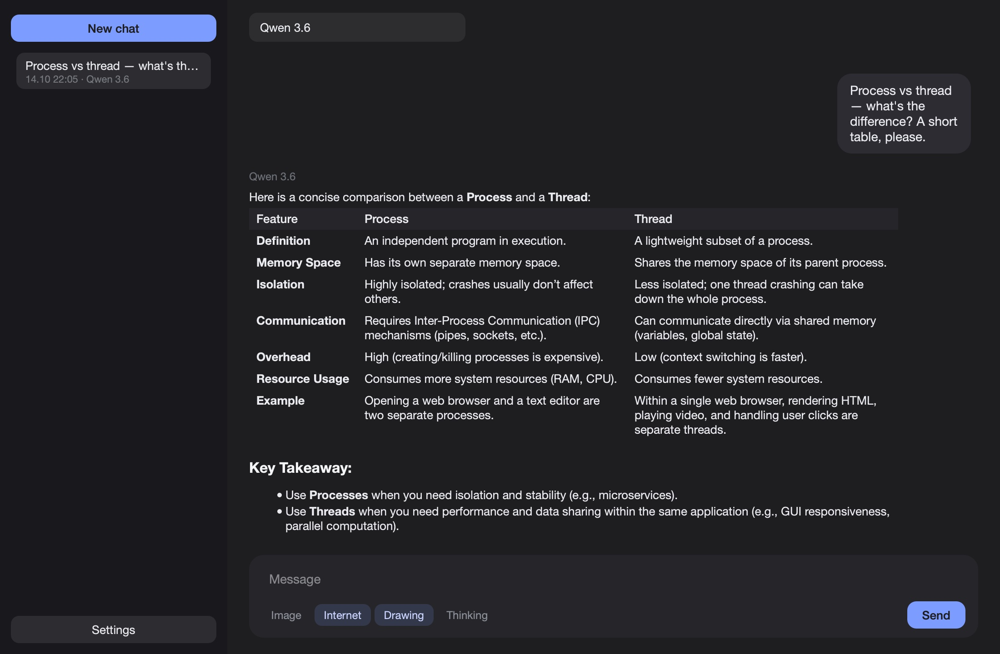

# tonix-gpt

Local chatbots on your Mac: Qwen, Gemma, gpt-oss and their uncensored
huihui builds. They search the web, see attached images and draw.

[Русский](#tonix-gpt-1)



## Download

**[tonix-gpt.dmg](https://github.com/Drtonix/Tonix-gpt/releases/latest/download/tonix-gpt.dmg)**

First launch goes through right-click → **Open** → **Open**. Then download a
model in **Settings**.

## Requirements

Apple Silicon, macOS 14 or newer.

| Model | Size | RAM | Images |
|---|---|---|---|
| Qwen 3.6, 35B-A3B | 19 GB | 32 GB | sees |
| Qwen 3.8, 27B | 15 GB | 24 GB | sees |
| Gemma 4, 26B-A4B | 14.6 GB | 24 GB | sees |
| Qwen 3, 8B | 4.3 GB | 16 GB | — |
| gpt-oss, 20B | 11.3 GB | 16 GB | — |
| Z-Image Turbo | 10.2 GB | 24 GB | draws |

Qwen 3.6 and Gemma 4 also come as huihui builds, and there are Qwen 3 30B and
32B. All weights are 4-bit MLX.

## Measured

MacBook Pro, M4 Max, 36 GB, Qwen 3.6: the first answer with the model loading
from disk in 14 s, then about 100 tokens/s. A picture takes about 30 s.

## Features

**Internet.** The model searches and reads pages when it needs fresh data;
sources are listed under the answer.

**Images.** Paste, drop or attach a picture: Qwen and Gemma see it.

**Drawing.** Ask for a picture and the model draws it with Z-Image Turbo.

**Thinking.** The model can reason before answering.

**Models anywhere.** On the built-in disk or in any folder, an external drive
included.

**Languages.** Russian and English, light and dark appearance.

## Build

```
git clone git@github.com:Drtonix/Tonix-gpt.git
cd Tonix-gpt
uv sync
./build_app.sh
```

To run from source: `uv run python app.py`.

## Limits

- One model in memory at a time. Drawing unloads the chat model, so the next
  answer starts with loading it again.
- When DuckDuckGo throttles requests, search falls back to Wikipedia.

## License

MIT, see [LICENSE](LICENSE). Bundled components and models are in
[THIRD-PARTY.md](THIRD-PARTY.md).

DrTonix · [bdub.space](https://bdub.space)

---

# tonix-gpt

Локальные чат-боты на вашем Mac: Qwen, Gemma, gpt-oss и их huihui-сборки без
цензуры. Ищут в интернете, видят приложенные картинки и рисуют.

[English](#tonix-gpt)


## Скачать

**[tonix-gpt.dmg](https://github.com/Drtonix/Tonix-gpt/releases/latest/download/tonix-gpt.dmg)**

Первый запуск — правой кнопкой → **Открыть** → **Открыть**. Затем скачайте
модель в **Настройках**.

## Требования

Apple Silicon, macOS 14 или новее.

| Модель | Размер | Память | Картинки |
|---|---|---|---|
| Qwen 3.6, 35B-A3B | 19 ГБ | 32 ГБ | видит |
| Qwen 3.8, 27B | 15 ГБ | 24 ГБ | видит |
| Gemma 4, 26B-A4B | 14,6 ГБ | 24 ГБ | видит |
| Qwen 3, 8B | 4,3 ГБ | 16 ГБ | — |
| gpt-oss, 20B | 11,3 ГБ | 16 ГБ | — |
| Z-Image Turbo | 10,2 ГБ | 24 ГБ | рисует |

Qwen 3.6 и Gemma 4 есть и в huihui-сборках, а ещё Qwen 3 30B и 32B. Все веса —
4-битные MLX.

## Замеры

MacBook Pro, M4 Max, 36 ГБ, Qwen 3.6: первый ответ вместе с загрузкой модели
с диска — 14 с, дальше около 100 токенов в секунду. Картинка — около 30 с.

## Возможности

**Интернет.** Модель ищет и читает страницы, когда нужны свежие данные;
источники — под ответом.

**Картинки.** Вставьте, перетащите или приложите картинку: Qwen и Gemma её
видят.

**Рисование.** Попросите картинку — модель нарисует её через Z-Image Turbo.

**Размышления.** Модель может рассуждать перед ответом.

**Модели где угодно.** На встроенном диске или в любой папке, хоть на внешнем
диске.

**Языки.** Русский и английский, светлое и тёмное оформление.

## Сборка

```
git clone git@github.com:Drtonix/Tonix-gpt.git
cd Tonix-gpt
uv sync
./build_app.sh
```

Из исходников: `uv run python app.py`.

## Ограничения

- В памяти одна модель. Рисование выгружает языковую модель, и следующий
  ответ начинается с её загрузки.
- Когда DuckDuckGo ограничивает запросы, поиск идёт по Википедии.

## Лицензия

MIT, см. [LICENSE](LICENSE). Компоненты и модели — в
[THIRD-PARTY.md](THIRD-PARTY.md).

DrTonix · [bdub.space](https://bdub.space)
